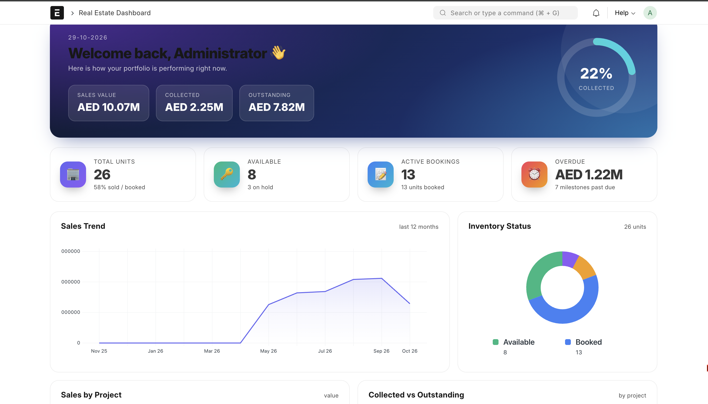
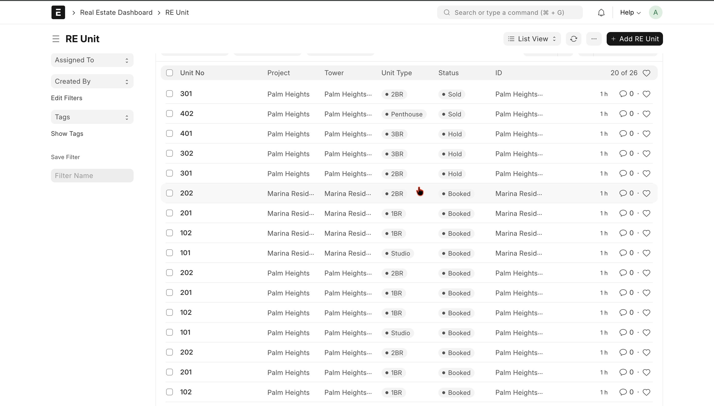
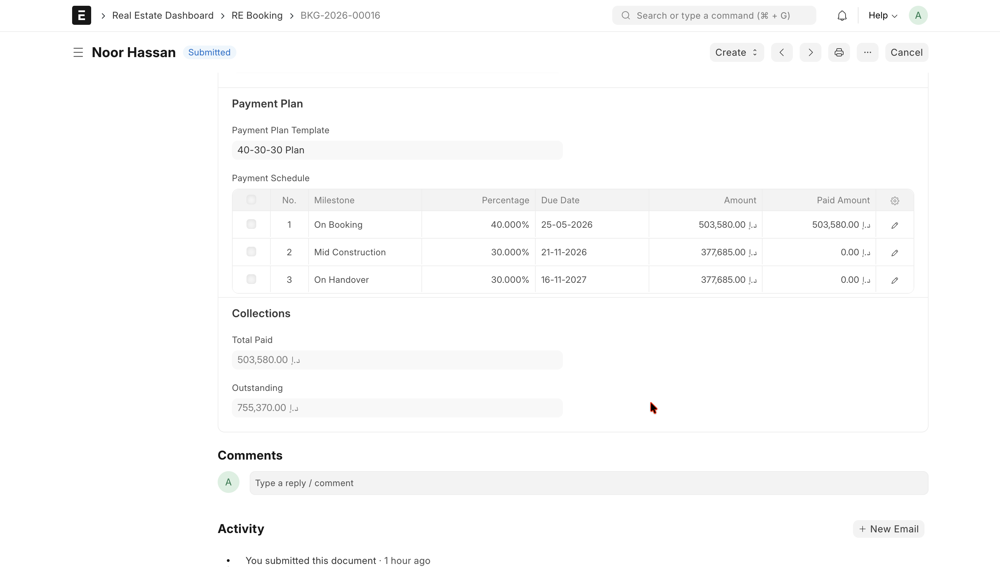
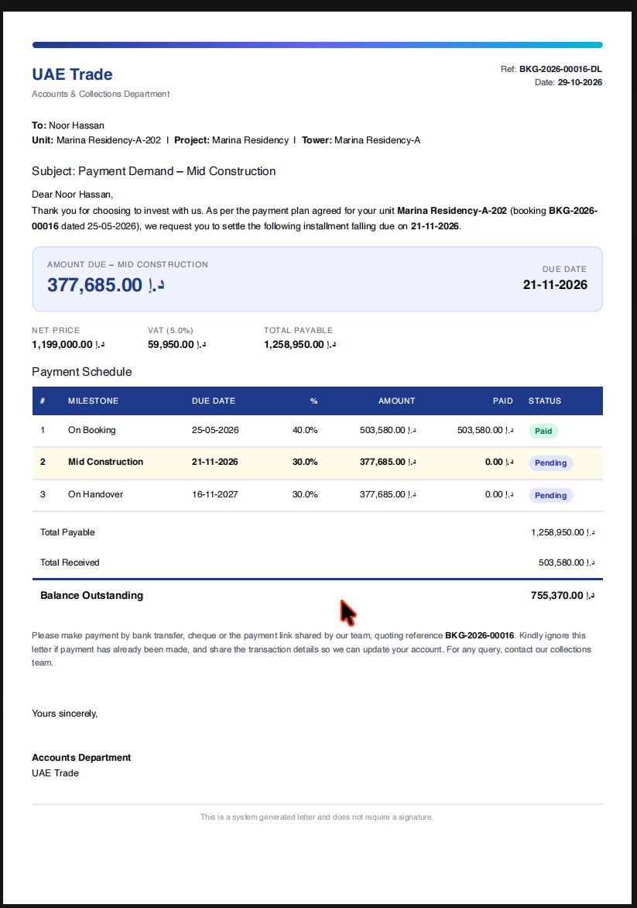

# UAE Real Estate: a Frappe / ERPNext app

A real estate ERP built as a custom Frappe app on top of ERPNext. It manages the full property sales cycle: **inventory, booking, milestone-based payment plans, collections, and reporting**, with VAT (5%) applied for UAE.

> Built with Python, JavaScript, Frappe Framework v15 and ERPNext.



## Features

| Area | What it does |
|---|---|
| **Inventory** | Project → Tower → Unit hierarchy. Unit price is calculated automatically from saleable area, base rate, floor rise, PLC and parking. Status lifecycle: Available → Hold → Booked → Sold. |
| **Booking** | Select customer, unit and payment plan. Net price, VAT and grand total are computed, and the payment schedule is generated automatically. A booked unit cannot be booked twice. Submit marks the unit *Booked*; cancel releases it. |
| **Payment plans** | Reusable templates (e.g. 10-20-30-40, 20-80, 40-30-30) with milestones, percentages and due dates. The schedule must total 100%. |
| **Collections** | One click from a booking creates an ERPNext **Payment Entry** for a milestone. Submitting or cancelling it updates the milestone status (*Pending / Partly Paid / Paid*) and the booking's *Total Paid* and *Outstanding*. |
| **Demand letter** | A branded PDF showing the next due milestone, overdue days, the full schedule and balance. It becomes a statement of account once everything is paid. |
| **Command Center** | A custom Desk page with animated KPIs, a collection ring, sales trend, inventory donut, sales / collections by project, a colour-coded **unit stack plan**, recent bookings and upcoming payments. |
| **Dashboard** | Standard Frappe Number Cards and Charts, included as fixtures. |

## Screenshots

| Command Center | Stack plan |
|---|---|
|  |  |

| Booking with payment schedule | Demand letter |
|---|---|
|  |  |

## Booking flow

```
RE Project ─► RE Tower ─► RE Unit  (price auto-calculated, status: Available)
                              │
Customer ──────────────► RE Booking  (VAT, grand total, schedule from plan template)
                              │ Submit
                              ▼
                        Unit = Booked
                              │
              Create ► Payment Entry  (ERPNext accounts)
                              │ Submit / Cancel  (doc_events hook)
                              ▼
        Milestone status + Total Paid + Outstanding update
                              │
                              ▼
        Command Center  ·  Number Cards  ·  Demand Letter PDF
```

## Data model

| DocType | Type | Purpose |
|---|---|---|
| `RE Project` | Master | Development / community |
| `RE Tower` | Master | Building or block, linked to a project |
| `RE Unit` | Master | A sellable unit with pricing and status |
| `RE Payment Plan Template` + `RE Payment Plan Item` | Master + child | Reusable milestone plans |
| `RE Booking` + `RE Booking Payment` | Submittable + child | A sale and its payment schedule |
| `Payment Entry` (ERPNext) | Extended | Custom fields `re_booking`, `re_booking_row` link a payment to a milestone |

## How it works (technical)

- **Document controllers** (`re_unit.py`, `re_booking.py`) hold the business rules: price calculation, availability checks, schedule generation, and status changes on submit / cancel.
- **Doc events hook** (`hooks.py`) runs `update_booking_payment` when an ERPNext Payment Entry is submitted or cancelled, so ERPNext's core is extended without being modified.
- **Whitelisted API** (`payments.make_payment_entry`, `dashboard_api.get_dashboard_data`) powers the booking button and the Command Center.
- **Client scripts and a custom Page** (`re_booking.js`, `page/re_dashboard`) provide the UI, built on `frappe.ui` and `frappe.Chart`.
- **Print format** (Jinja) renders the demand letter.
- **Fixtures** export the dashboard, number cards, charts, workspace and custom fields so the app installs fully configured.

## Requirements

- Frappe Framework v15 and ERPNext v15
- Python 3.11, Node 18+, MariaDB, Redis
- `wkhtmltopdf` (with patched Qt) for PDF generation

## Installation

```bash
bench get-app https://github.com/<your-username>/uae_real_estate.git
bench --site <your-site> install-app uae_real_estate
bench --site <your-site> migrate
bench restart
```

Complete the ERPNext setup wizard first. Payment Entries need a **Company** with a default receivable account and a default cash or bank account.

### Load demo data

```bash
bench --site <your-site> execute uae_real_estate.seed_data.run
```

Creates 2 projects, 3 towers, 24 units, 12 customers, 3 payment plans, 12 bookings and about 15 payments. Remove it again with `uae_real_estate.seed_data.clear`.

### Open the dashboard

- Command Center: `/app/re-dashboard`
- Standard dashboard: `/app/real-estate-dashboard`

## Tests

An end-to-end script runs the whole flow (inventory → booking → double-booking check → payments → cancellation) and prints PASS / FAIL for each check:

```bash
bench --site <your-site> execute uae_real_estate.e2e_test.run
```

## Roadmap

- Sales Invoice with VAT tax template and payment reconciliation
- Channel partner management and commissions
- Lead / CRM pipeline with site-visit scheduling
- WhatsApp and email reminders for due milestones
- Customer portal for statements and payment history
- RERA / Oqood compliance tracking
- Unit tests with `frappe.tests`

## License

MIT
